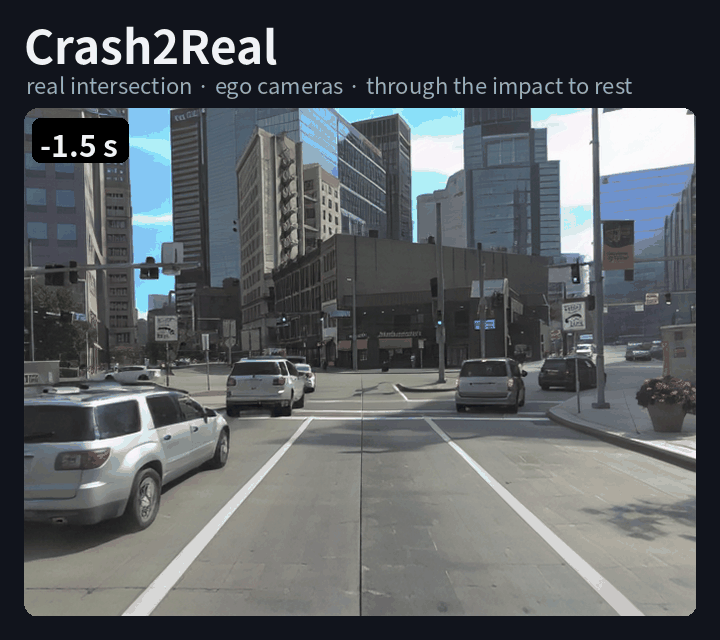
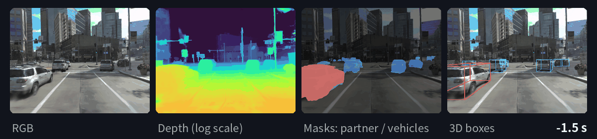
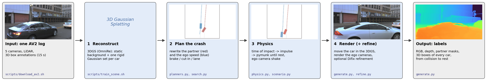
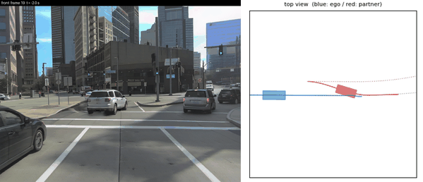
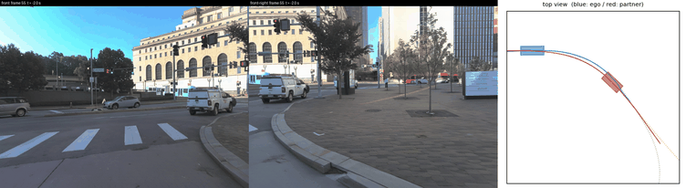
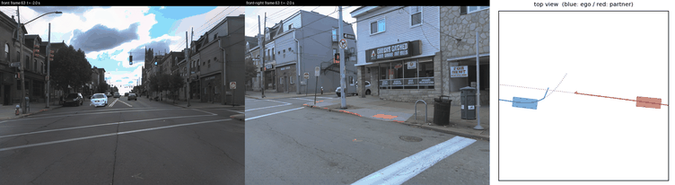
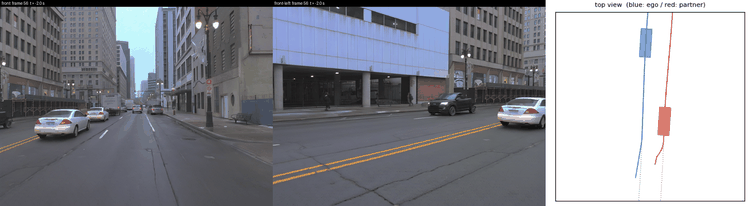

# Crash2Real

Collision scenes at real intersections, seen from the ego car's cameras, from before the impact until the cars come to rest, with ground-truth labels.

**Paper**: [preprint on Zenodo](https://doi.org/10.5281/zenodo.24492042)



A recorded drive is reconstructed with 3D Gaussian Splatting. The recorded car tracks are rewritten so that two cars collide, the motion after the impact is computed with rigid-body physics, and the ego cameras are rendered together with depth, masks and 3D boxes. Crash2Real is a tool for building **evaluation data** for perception after a collision; we do not claim that training on it improves real-world performance.

We generated **162 cases at 19 intersections in 4 cities** (91 rear-end, 46 cut-in, 25 oblique / side / sideswipe). Every frame comes with labels from the reconstructed geometry:



## How it works



| Step | What happens | Code |
| --- | --- | --- |
| 1. Reconstruct | An Argoverse 2 log (5 cameras, LiDAR, box annotations, 15 s) is reconstructed with [drivestudio](https://github.com/ziyc/drivestudio) (OmniRe). Each car is a separate rigid set of Gaussians, so it can be moved. | `scripts/train_scene.sh` |
| 2. Plan | Find a car to collide with and rewrite its track (a car ahead brakes hard, a car cuts in from the next lane, or a car stays in its lane and sideswipes). The ego may drive faster along its recorded path. | `crash2real/planners.py`, `crash2real/search.py` |
| 3. Physics | Find the exact moment the boxes touch, apply a point impulse (restitution depends on the closing speed), then simulate both cars until rest with [pymunk](https://www.pymunk.org/) and road friction. The ego camera follows the ego body and shakes. | `crash2real/physics.py`, `crash2real/scenario.py` |
| 4. Render | Write the new tracks into the 3DGS scene and render the ego cameras. A poorly reconstructed partner can be drawn with the Gaussians of a better car. Optionally refine the frames with [Difix](https://github.com/nv-tlabs/Difix3D). | `crash2real/generate.py`, `crash2real/refine.py` |
| 5. Labels | Depth, partner masks (visible and amodal), all-vehicle masks and the 3D boxes of every car in world, camera and image coordinates. Labels come from the geometry, before refinement. | `crash2real/generate.py` |

## Gallery

Left: front camera · middle: front-side camera · right: top view (blue = ego, red = partner). A red bar marks the frames after the impact.

<table>
  <tr>
    <td width="50%"><b>Cut-in</b>: a car from the next lane cuts in and brakes<br></td>
    <td width="50%"><b>Rear-end during a right turn</b><br></td>
  </tr>
  <tr>
    <td><b>Oblique impact</b> inside the intersection<br></td>
    <td><b>Cut-in</b>, the ego keeps its recorded drive<br></td>
  </tr>
</table>

The images are derived from Argoverse 2 (CC BY-NC-SA 4.0) and are shared under the same terms.

## What we checked

Partners are 41 different cars, but only 21 different appearances are drawn, because many partners are drawn with a better-reconstructed car. Three side impacts used an appearance-generation step that is not in this repository.

| Check | Result |
| --- | --- |
| Depth labels vs. LiDAR | AbsRel 0.084. A monocular depth model on the real image, even rescaled to the ground truth, reaches 0.191. |
| Moved cars seen from new, close views | Surface depth holds (AbsRel 0.09-0.12 at 0-5 m); masks spill over the outline at close range. |
| Physics vs. real crash tests | Speed change within 5-6 % (rear impact) and 1.1 m/s (side impact). Rotation is rough; rest positions do not match. |
| Rendered vs. real images | Five detectors keep roughly the same ranking on rendered and real images (AP50 difference +0.006 to +0.030). On unseen close views the rendering is pessimistic (near-car AP 0.04-0.28 lower, 0.01-0.14 after refinement). |

The physics checks can be rerun with `python validation/crash_tests.py`. The other evaluations are described in the paper and are not part of this repository.

**Limitations.** Cars are rigid boxes (no crush). Most rear-end cases make the ego 2-3 times faster than recorded. Other recorded cars do not react to the crash. There is no driver steering or braking after the impact. Close-range partners can break up when rendered; refinement fixes the look but its details (windows, plates, wheels) are generated. Mass, friction and car sizes are assumptions. Always look at the frames before using a case.

## Quick start

Tested on WSL2 (Ubuntu) with an RTX A6000 (48 GB). Training takes 1-3 h per scene and about 22 GB of GPU memory; run one GPU job at a time.

**1. Set up** (from the repository root)

```bash
git clone --recursive https://github.com/ziyc/drivestudio.git
(cd drivestudio && git checkout e59bda4 && git apply ../patches/*.patch)
bash scripts/setup_drivestudio_env.sh   # conda env "drivestudio"
bash scripts/setup_segformer_env.sh     # conda env "segformer" (sky masks)
bash scripts/setup_difix_env.sh         # conda env "difix" (optional refinement, non-commercial license)
```

**2. Download and reconstruct a log.** `configs/av2_logs.txt` lists the 26 logs we used; the scene index is the line number minus one.

```bash
export AV2_DIR=$HOME/data/argoverse
bash scripts/download_av2.sh get val $(sed -n 1p configs/av2_logs.txt)
bash scripts/train_scene.sh 0
```

**3. Generate cases.** This searches the scene for rear-end and cut-in collisions, renders each case with labels, refines it, and writes a preview GIF.

```bash
bash scripts/run_scene.sh 0             # -> outputs/scene0/<case>/ and outputs/scene0/gifs/
```

<details>
<summary><b>Run the steps by hand</b> (in the <code>drivestudio</code> environment, from the repository root)</summary>


```bash
python -m crash2real.search rear --scene_idx 0 --run outputs/av2/a7636fca_omnire --out outputs/scene0/cases_rear.json
python -m crash2real.generate --run outputs/av2/a7636fca_omnire --instance 7 --planner brake \
    --ego_scale 2.5 --ego_ramp_start 70 --t0 80 --tc 102 --brake_a 5 --cams 0 1 3 --out_dir outputs/my_case
python -m crash2real.make_gif outputs/my_case --cams 0 1 --out outputs/my_case.gif
```

</details>

<details>
<summary><b>What is in a case folder</b></summary>


```
scenario.json                 case options, contact frame, ego and partner trajectories, speed change
cam{c}/rgb_{f}.png            rendered frame          cam{c}/depth_{f}.npz   depth [m] and opacity
cam{c}/mask_partner_visible_{f}.png  mask_partner_amodal_{f}.png  mask_vehicles_{f}.png
boxes.json                    3D boxes of every car per frame and camera
refined_cam{c}/rgb_{f}.png    refined frame (optional)
viz/                          overlays for checking
```

Cameras: 0 front, 1 front-left, 2 front-right, 3 side-left, 4 side-right. Cameras 2-4 are rendered with the front-left camera's intrinsics (a drivestudio limitation).

</details>

**4. Check the physics** (numpy and pymunk only):

```bash
python validation/test_physics.py    # conservation laws, analytic cases, friction cone, no penetration
python validation/crash_tests.py     # four real crash tests
```

## Repository layout

```
crash2real/
  physics.py     impulse, restitution model, box overlap, pymunk post-impact simulation
  planners.py    recorded tracks, ego retiming, brake / cut-in / lane planners
  scenario.py    time of impact, build one case, ego camera shake, shared case options
  scene.py       load a trained drivestudio scene, move and re-skin cars, render
  search.py      find rear-end and cut-in cases in a scene
  generate.py    render one case with labels
  refine.py      Difix refinement (optional)
  make_gif.py    preview GIF with a top view
scripts/         environment setup, AV2 download, reconstruction, one-scene pipeline
validation/      physics self-checks and real crash tests
configs/         drivestudio config and the AV2 log list
patches/         changes to drivestudio e59bda4
```

## License

- **Code**: [MIT](LICENSE).
- **Example images** (`docs/media`): derived from Argoverse 2, shared under CC BY-NC-SA 4.0 (non-commercial, share alike).
- **Data you generate** from Argoverse 2 stays under the Argoverse 2 terms. **Difix** (optional refinement) is under the NVIDIA License, non-commercial only. Other third-party licenses are listed in [THIRD_PARTY_LICENSES.md](THIRD_PARTY_LICENSES.md).
- No weights or data are included; only how to get them.

## Citation

The paper is available as a preprint on Zenodo: [doi:10.5281/zenodo.24492041](https://doi.org/10.5281/zenodo.24492041).

```bibtex
@misc{taue2026crash2real,
  title     = {Crash2Real: Labeled Ego-View Data Through and After Collisions, Generated on Reconstructions of Real Intersections},
  author    = {Taue, Ikumi},
  year      = {2026},
  publisher = {Zenodo},
  doi       = {10.5281/zenodo.24492041},
  url       = {https://doi.org/10.5281/zenodo.24492041},
  note      = {Preprint}
}
```
